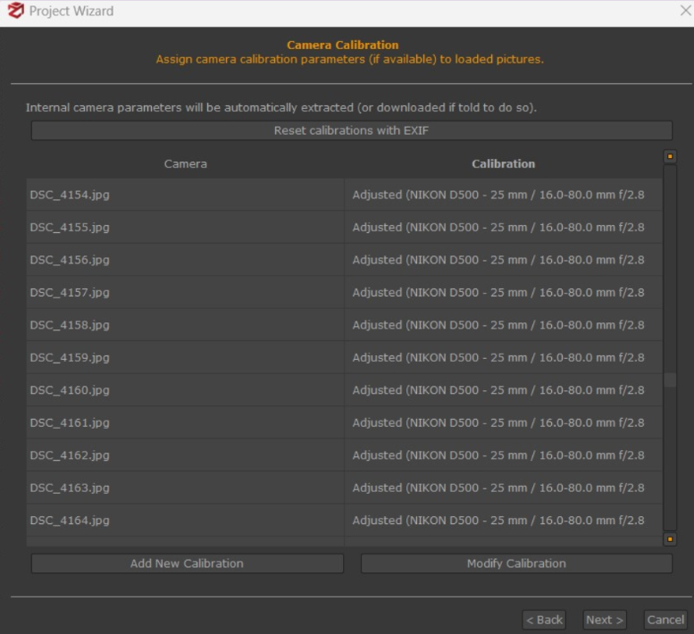
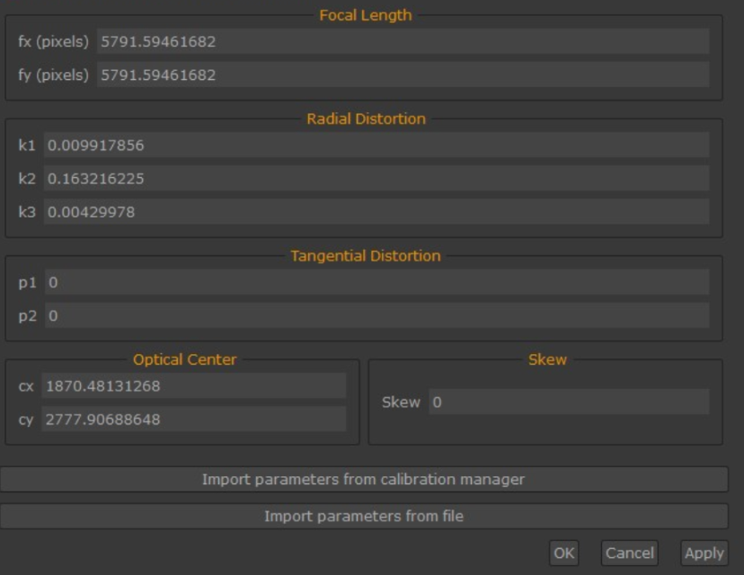

# 3DF Zephyr Calibration Import

To use the multi-camera calibration obtained from Kalibr inside 3DF Zephyr, the calibration parameters must first be converted into Zephyr-compatible XML files. Zephyr does not accept Kalibr's YAML or TXT formats directly, so an intermediate conversion step is required.

Example input and output files are provided in:

- `input example/`
- `output example/`

## Step 1 - Prepare a Working Folder

Create a folder containing:

- The Kalibr output file:

```text
camchain-Calibrationall_cams_calibration.yaml
```

- The conversion script:

```text
calib_transform.py
```

The input YAML file should come from the Kalibr calibration output.

## Step 2 - Run the Conversion Script

From inside the working folder, execute:

```bash
python calib_transform.py camchain-Calibrationall_cams_calibration.yaml
```

The script parses the Kalibr camera intrinsics and distortion parameters and converts them into the XML calibration format required by 3DF Zephyr.

For each camera, the script generates one XML file, for example:

```text
calibration_cam0_aux_right.xml
calibration_cam1_aux_left.xml
calibration_cam2_bottom_most.xml
calibration_cam3_stereo_bottom.xml
```

## Step 3 - XML Contents

Each generated XML file contains:

- Intrinsic parameters: `fx`, `fy`, `cx`, `cy`
- Distortion coefficients: `k1`, `k2`, `p1`, `p2`, `k3`
- Camera name, matching the original camera topic/name
- Camera model, usually `pinhole`, in a format compatible with 3DF Zephyr

## Step 4 - Import into 3DF Zephyr

Inside 3DF Zephyr, when starting a new project or adjusting the camera settings, go to **Camera Calibration**.



Choose **Import Parameters from File**.



Select the corresponding `.xml` file generated by `calib_transform.py`.

Zephyr will load the calibrated intrinsics and distortion parameters and apply them during reconstruction. This ensures that the 3D reconstruction uses the same camera model estimated in Kalibr, improving accuracy and consistency across the multi-camera system.
