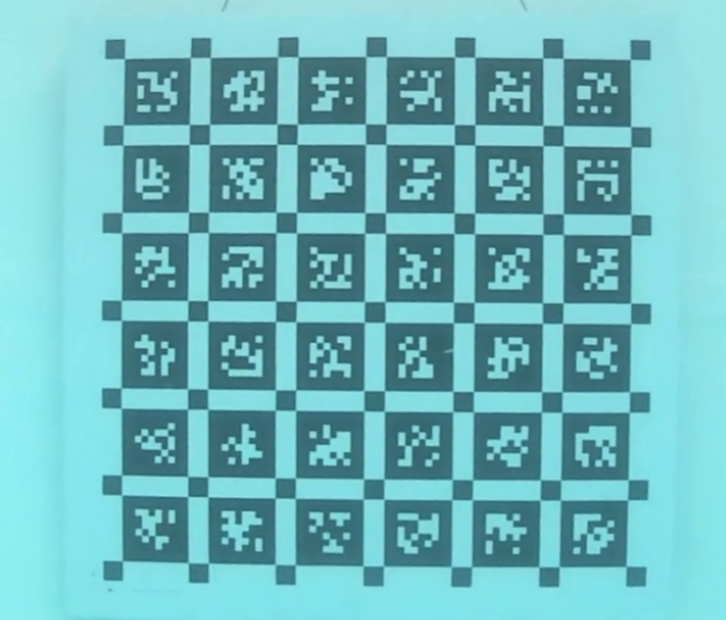

# Calibration

The calibration dataset is recorded with the BlueROV2 underwater, capturing a 6x6 checkerboard pattern with 88 mm squares while maneuvering the vehicle around it. The board is observed from a wide range of angles, distances, and positions, ensuring that all cameras acquire overlapping images covering different areas of the frame.

This variability is crucial for camera calibration: changing distance helps constrain the focal length, while placing the checkerboard near edges and corners allows accurate estimation of radial and tangential distortion. Together, these diverse observations enable reliable estimation of both intrinsic parameters, such as focal length and radial/tangential distortion, and extrinsic orientations between cameras. This ultimately enables robust multi-camera calibration across the full field of view.

## Contents

- `Calibration GUI for Kalibr/`: graphical preprocessing tool for extracting Kalibr-compatible calibration image sets from the multi-camera videos.
- `Kalibr/`: calibration inputs, outputs, and checkerboard target configuration for Kalibr.
- `3DF Zephyr/`: tools and examples for converting calibration parameters into formats usable in 3DF Zephyr.
