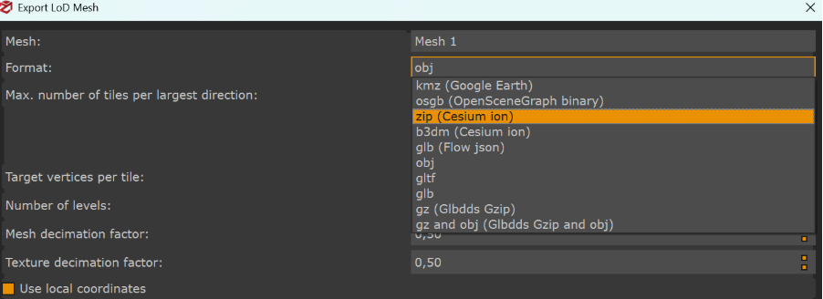

# GUI Preprocessing

Extracts synchronized frames from the 4 BlueROV2 camera videos for 3D reconstruction and, if navigation data is given, georeferences them for 3DF Zephyr (EXIF) and Cesium (`tileset.json`).


## Run

```bash
python gui_preprocessing.py
```

1. **Dataset**: folder with the 4 videos (filenames must contain `aux_right`, `aux_left`, `bottom_most`, `stereo_bottom`). Typically a transect cropped with the [GUI Navigation Transects](../GUI%20navigation%20transects/).
2. **Navigation data** (optional): the transect CSV, `<transect>_cam0_frames.csv` from the GUI Navigation Transects (one row per frame). Leave empty to save the frames as PNG without georeferencing.
3. **Keyframes**: `Auto` (AAFE, optical-flow / feature-matching based selection) or `Fixed` (one frame every N).
4. **Filtering**: `Raw`, `Turbid` (white balance + CLAHE) or `Clear` (subtle sharpening).
5. **Start**.

Command line: `python main_preprocessing.py <dataset> [--keyframe-mode auto|fixed] [--mode raw|clear|turbid] [--nav <csv>]`.

## Output

```text
<dataset>/
+-- processed_frames/                        only the 4 camera folders
|   +-- cam0_aux_right/ ... cam3_stereo_bottom/
|       camX_img_<frame>_best.jpg            with navigation: GPS EXIF (same frame = same instant)
|       camX_img_<frame>_best.png            without navigation
+-- keyframes.txt                            selected frames and why (Auto mode)
# only with navigation data:
+-- geotags.csv                              what was written into each image (position, attitude, rig offset)
+-- external_georeferencing/
    +-- tileset.json, focus_config.json, origin.csv
```

`<frame>` is the frame number in the transect videos, from 0: the image `camX_img_<n>_best.jpg` is the row `Frame = n` of `<transect>_cam0_frames.csv`.

## Georeferencing (with navigation data)

- **Internal (3DF Zephyr, EXIF)**: **every saved frame of every camera** is a JPG with GPS EXIF (latitude, longitude, depth below sea level, capture time to the millisecond). cam0 (aux_right) takes the position of its row in `<transect>_cam0_frames.csv` (exact capture time of that frame, synchronised with the video). cam1..cam3 get cam0's position plus their rig offset (22 x 11 cm plate, pitched 40° down), rotated with the ROV roll/pitch/heading of that frame; without attitude in the CSV the ROV is assumed level and the heading is taken from the track. Frames outside the navigation recording are saved without GPS (the log says how many). Import the camera folders into Zephyr as usual and it reads the EXIF GPS to georeference the project. The georeferenced model can be exported from Zephyr directly in a Cesium ion-compatible format.

  

- **External (Cesium, `tileset.json`)**: for a model built in local coordinates (run without navigation data for plain PNGs, or let Zephyr ignore the EXIF). `tileset.json` places the model at the first navigation position with an East-North-Up orientation and a bounding box fitted to the navigation track. Export the model as `<dataset>.glb` and upload it together with `tileset.json` to Cesium ion as a 3D Tiles asset.

## Files

| File | Purpose |
|------|---------|
| `gui_preprocessing.py` | GUI (Tkinter) |
| `main_preprocessing.py` | Frame extraction pipeline (also CLI) |
| `key_frame_selection_auto.py` | AAFE automatic keyframe selection |
| `filter.py` | Turbid / clear water filters |
| `nav_georef.py` | Navigation interpolation, EXIF geotagging and `tileset.json` |
