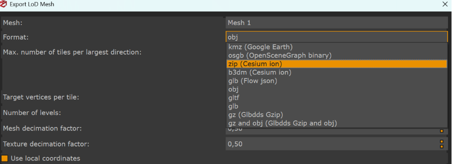

# Internal Georeferencing via EXIF Metadata for 3DF Zephyr

In this workflow, the script `geotag_images_exif.py` is used to embed geographic information directly into the EXIF metadata of selected images. These EXIF tags are later read by 3DF Zephyr to perform internal georeferencing during the reconstruction process.

## Directory Structure

```text
Internal Georeferencing via EXIF metadata for 3DF Zephyr/
+-- geotag_images_exif.py
+-- input example/
|   +-- 22_05_2025_ptsag_102940.001-103010.02.csv
+-- output example/
    +-- geotagged_jpg/
        +-- cam0_img_0_best.jpg
```

## Script Usage

Run:

```bash
python3 geotag_images_exif.py <image_dir> <csv_path>
```

Where:

- `<image_dir>` is the directory containing the original processed image frames extracted from the multi-camera video.
- `<csv_path>` is the CSV file containing the positional information, including latitude, longitude, and depth, corresponding to the start and end of the video sequence.

Note: this script requires `exiftool` to be installed. On Windows, install ExifTool and make sure the executable is either available in the system `PATH` or placed in the expected local `tools/` location used by the script.

## Description of the Process

The script reads the CSV file and extracts the first and last valid geographic positions: latitude, longitude, and depth.

It then:

- Converts the first and last images in `<image_dir>` from PNG to JPEG format.
- Writes GPS EXIF metadata, including latitude, longitude, and altitude/depth, into these two images.
- Stores the resulting files in a newly created `geotagged_jpg/` output directory.

Only the first and last frames are geotagged, as these provide sufficient spatial constraints for internal georeferencing in 3DF Zephyr.

## Integration with 3DF Zephyr

After the script finishes:

1. Replace the corresponding first and last images in the original image directory with the geotagged versions, keeping the same filenames.
2. Import the full image set into 3DF Zephyr as usual.
3. During reconstruction, 3DF Zephyr automatically reads the EXIF GPS metadata from the geotagged images and uses it to internally georeference the project.

When the 3D model is generated, 3DF Zephyr also provides an option to export the LoD mesh directly in a Cesium ion-compatible format, which can then be used in Cesium.


