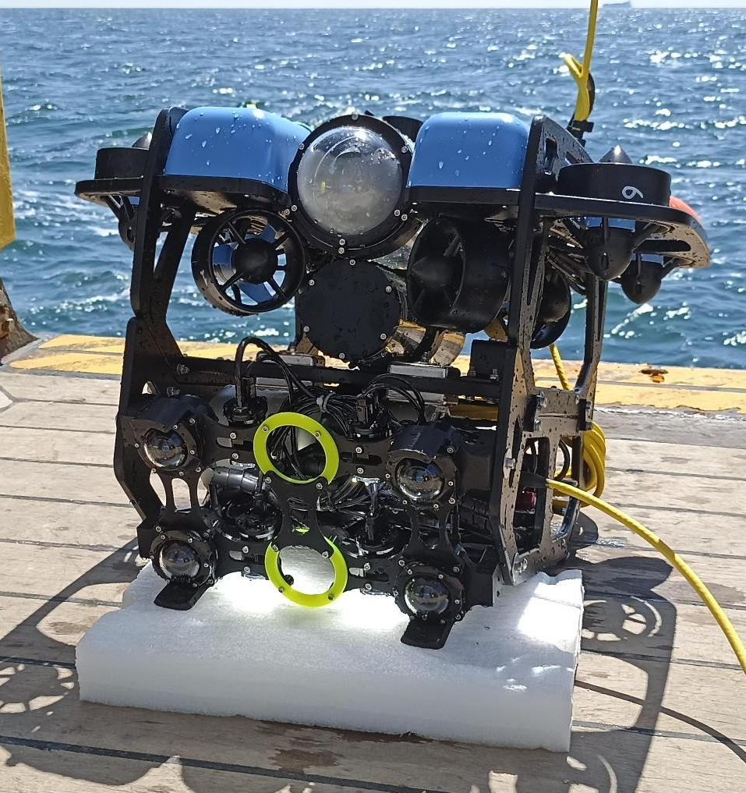

# 3D Reconstruction Multi-Camera BlueROV2

This repository contains tools for 3D reconstruction using a multi-camera setup mounted on a BlueROV2 platform.

The project is developed at DTU Aqua and focuses on underwater image preparation and preprocessing, camera calibration and georeferencing of generated 3D models.

The workflow is designed for datasets captured with four synchronized cameras and supports both clear-water and turbid-water conditions.




## Project Overview

The main workflow includes:

1. **[Calibration](Calibration/)**
   - Kalibr-compatible calibration inputs and outputs.
   - A dedicated [Calibration GUI for Kalibr](Calibration/Calibration%20GUI%20for%20Kalibr/) for generating Kalibr-compatible image sets.
   - Conversion tools for exporting calibration parameters to formats usable in [3DF Zephyr](Calibration/3DF%20Zephyr/).

2. **[GUI Navigation Transects](GUI%20navigation%20transects/)**
   - A graphical interface to crop the four camera videos of a mission to a transect and convert them to MP4.
   - Uses the ROV navigation data to compute the georeferenced position (latitude, longitude, depth) at the first and last frame of the crop, written to a CSV file.
   - Position can be reported for `cam0` (camera) or for the vehicle (IMU).
   - Inputs (not included in the repository): the four `.mkv` videos of the mission downloaded with the ROV GUI, and the navigation data folder of the same mission (an example is included).

3. **[GUI Preprocessing](GUI%20preprocessing/)**
   - A graphical interface for selecting preprocessing options.
   - Support for three image-processing modes:
     - `raw`: extracts frames without image enhancement.
     - `clear`: applies enhancement intended for clear-water imagery.
     - `turbid`: applies color restoration and filtering intended for turbid-water imagery.
   - Support for two keyframe selection strategies:
     - `fixed`: extracts frames at a fixed interval.
     - `auto`: selects representative frames using AAFE, a visual-odometry-based keyframe selection strategy.

4. **[Georeferencing](Georeferencing/)**
   - [Internal georeferencing](Georeferencing/Internal%20Georeferencing%20via%20EXIF%20metadata%20for%203DF%20Zephyr/) by writing GPS/depth metadata into image EXIF fields for use in 3DF Zephyr.
   - [External georeferencing](Georeferencing/External%20Georeferencing%20via%20Transformation%20JSON%20for%20Cesium/) by generating transformation data for Cesium-based visualization of exported 3D models.

5. **[Tools](Tools/)**
   - General-purpose helpers, such as a video cropper to cut a section of any video and convert it to a common format (MP4).

## Typical Workflow

1. Capture synchronized video from the BlueROV2 multi-camera system and download the videos and navigation data with the ROV GUI.
2. Calibrate the cameras using Kalibr or an equivalent calibration workflow.
3. Convert calibration outputs if needed for 3DF Zephyr.
4. Crop the transect of interest with the [GUI Navigation Transects](GUI%20navigation%20transects/), which converts the videos to MP4 and gives the georeferenced start and end position of the transect. (For a plain crop without georeferencing, use the video cropper in [Tools](Tools/).)
5. Extract keyframes using the preprocessing GUI.

   **Image enhancement mode:**

   - `raw`: extracts frames without image enhancement.
   - `clear`: applies image enhancement for clear-water conditions.
   - `turbid`: applies color restoration and filtering for turbid-water conditions.

   **Keyframe extraction strategy:**

   - `fixed`: extracts frames at regular frame intervals.
   - `auto`: selects keyframes automatically using optical-flow-based motion analysis.

6. Reconstruct the 3D model in external photogrammetry software.
7. Georeference the model internally with EXIF metadata or externally with Cesium transformation files.

## Data Not Included

Large mission data is excluded from the repository through `.gitignore`:

- `GUI navigation transects/videos/`: the four camera `.mkv` videos of the mission (`video_aux_right`, `video_aux_left`, `video_bottom_most`, `video_stereo_bottom`).
- `GUI navigation transects/output/`: the cropped MP4 videos and georeferencing CSV generated by the GUI.

See the [GUI Navigation Transects README](GUI%20navigation%20transects/) for the expected inputs.

## Dependencies

The Python dependencies are listed in `requirements.txt`. Install them with:

```bash
pip install -r requirements.txt
```

The requirements file includes the main Python packages used by the project:

- OpenCV
- NumPy
- Pillow
- pandas
- pyproj
- PyYAML

Some workflows also require external command-line tools that are not installed with `pip`:

- `ffmpeg` (and `ffprobe`): required by the video cropper in Tools and by the GUI Navigation Transects.
- `exiftool`: required by the EXIF georeferencing workflow.
