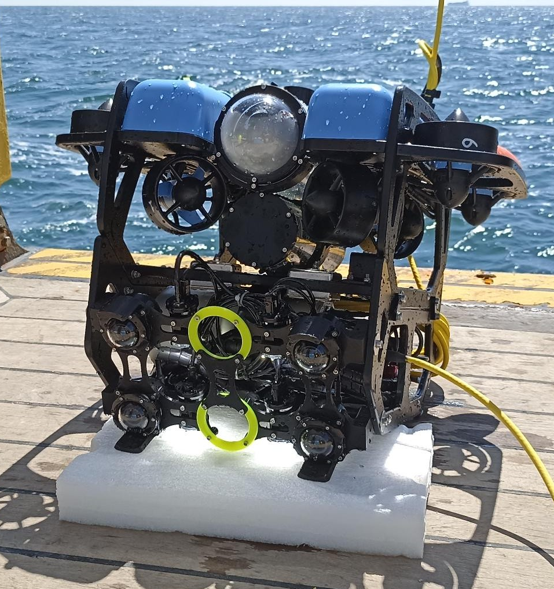

# 3D Reconstruction Multi-Camera BlueROV2

This repository contains tools for 3D reconstruction using a multi-camera setup mounted on a BlueROV2 platform.

The project is developed at DTU Aqua and focuses on underwater image preparation and preprocessing, camera calibration and georeferencing of generated 3D models.

The workflow is designed for datasets captured with four synchronized cameras and supports both clear-water and turbid-water conditions.




## Project Overview

The main workflow includes:

1. **[Calibration](Calibration/)**
   - Kalibr-compatible calibration inputs and outputs.
   - A dedicated [Calibration GUI for Kalibr](Calibration/Calibration%20GUI%20for%20Kalibr/) for generating Kalibr-compatible image sets.
   - Conversion tools for exporting calibration parameters to formats usable in [3DF Zephyr](Calibration/3DF%20Zephyr/).

2. **[GUI Navigation Transects](GUI%20navigation%20transects/)**
   - Crops the four camera videos of a mission to a transect and converts them to MP4.
   - Writes the transect navigation from the ROV data: position (latitude, longitude, depth) and ROV attitude (roll, pitch, heading), at the first/last frame and for every timestamp in between.

3. **[GUI Preprocessing](GUI%20preprocessing/)**
   - Extracts synchronized keyframes (`auto` AAFE or `fixed` interval) with `raw`, `clear` or `turbid` image processing.
   - With the transect navigation CSV it also georeferences the result:
     - **Internal (3DF Zephyr)**: GPS EXIF in the first/last frame of every camera, using the rig offsets and the ROV attitude.
     - **External (Cesium)**: `tileset.json` placing a model built in local coordinates on the globe.

4. **[Tools](Tools/)**
   - General-purpose helpers, such as a video cropper to cut a section of any video and convert it to a common format (MP4).

## Typical Workflow

1. Capture synchronized video from the BlueROV2 multi-camera system and download the videos and navigation data with the ROV GUI.
2. Calibrate the cameras using Kalibr or an equivalent calibration workflow.
3. Convert calibration outputs if needed for 3DF Zephyr.
4. Crop the transect of interest with the [GUI Navigation Transects](GUI%20navigation%20transects/) (MP4 videos + navigation CSV). For a plain crop without navigation, use the video cropper in [Tools](Tools/).
5. Extract keyframes with the [GUI Preprocessing](GUI%20preprocessing/), giving it the transect navigation CSV to georeference the frames.
6. Reconstruct the 3D model in 3DF Zephyr: georeferenced through the EXIF GPS of the frames, or in local coordinates and placed in Cesium with the generated `tileset.json`.


## Dependencies

The Python dependencies are listed in `requirements.txt`. Install them with:

```bash
pip install -r requirements.txt
```

The requirements file includes the main Python packages used by the project:

- OpenCV
- NumPy
- Pillow
- PyYAML

`ffmpeg` and `ffprobe` (not installed with `pip`) are required by the video cropper in Tools and by the GUI Navigation Transects.
